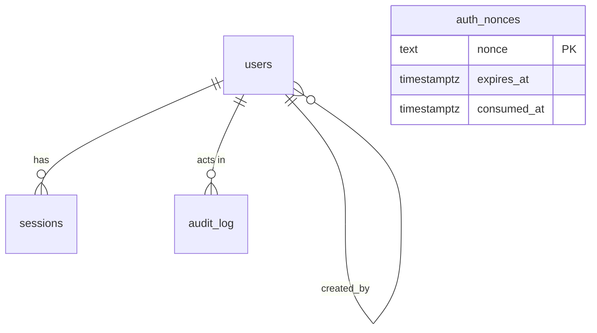

# Spec 1.2: Database schema and migrations

Phase: 1. Status: **draft for owner approval.** Depends on: 1.1 (API skeleton, for the database plugin and CI service). Blocks: 1.3.
Roadmap decisions this relies on: D3 trusted operator (the agency runs the database), D8 retention (open).

## Goal

A PostgreSQL schema, migration process and privilege model that is **correct and tamper-resistant from day one** for the identity and audit data that Phase 1 needs, and that sets the integrity conventions the evidence and custody tables will follow in Phases 2 and 3.

## Context

- There is no database today; all data is fictional in `src/data/mockData.js`.
- The system is for law enforcement. The audit trail and (later) the custody log are evidence themselves. The database must make silent edits hard, and make any edit detectable.
- Local machine has **no Docker and no PostgreSQL**. CI can use a `postgres:16` service container.

## Scope decision (differs from the roadmap's Phase 1 bullet)

The roadmap lists `users, roles, cases, evidence, custody_events, sessions, audit_log`. This spec recommends creating **only the tables Phase 1 uses**: `users`, `auth_nonces`, `sessions`, `audit_log`, plus the database roles and privileges. `cases`/`case_members`/`evidence` arrive with the Phase 2 endpoints that use them, and `custody_events` with Phase 3. Reason: schemas written before their endpoints exist get rewritten. The design constraints for the later tables are fixed now (section "Conventions for later tables") so they are not surprises. Owner can override (Q-B2).

## Design

### Tooling

| Concern | Choice | Why |
| --- | --- | --- |
| Database | PostgreSQL 16 | Triggers, column-level grants and roles are central to the integrity design. |
| Migrations | Plain SQL files, `api/migrations/0001_*.sql`, applied by `node-pg-migrate` | Reviewable line by line; supports roles, grants and triggers that ORM-generated migrations handle poorly. Checksums detect edited migrations. |
| Runtime access | `pg` pool with a thin typed query layer (Kysely) | Typed queries without hiding SQL. |
| Policy | **Forward-only.** No down migrations in production; recovery is restore-from-backup or a new forward migration. | Down migrations that drop data are a hazard for evidence systems. |

### Database roles (least privilege)

| Role | Used by | Can |
| --- | --- | --- |
| `fl_owner` | migration runner only | DDL; owns objects. Never used by the running API. |
| `fl_app` | the API at runtime | Only the DML listed per table below. Cannot create, alter or drop anything. |
| `fl_readonly` | reports, analysts, the future verification job | `SELECT` only. |

`DATABASE_URL` for the API uses `fl_app`. A separate `MIGRATION_DATABASE_URL` is used only by the migrate command.

The migration sets role-level limits instead of connection startup parameters (which poolers such as PgBouncer often reject): `alter role fl_app set statement_timeout = '10s'` and `alter role fl_app set idle_in_transaction_session_timeout = '15s'`. The API also applies a client-side `query_timeout` as a second line of defence.

### Tables (migration 0001)

All timestamps are `timestamptz` in UTC from the database clock (`now()`). Hashes and tokens are `bytea`, never hex text. Wallet addresses are stored **lowercase** (`0x` + 40 hex) and displayed in EIP-55 checksum form.

```sql
create type user_role   as enum ('admin', 'officer', 'reviewer');
create type user_status as enum ('invited', 'active', 'suspended');

create table users (
  id             uuid primary key default gen_random_uuid(),
  wallet_address text not null unique check (wallet_address ~ '^0x[0-9a-f]{40}$'),
  display_name   text not null check (char_length(display_name) between 1 and 120),
  agency_id      text check (char_length(agency_id) <= 64),      -- badge / employee number (Q-B5)
  role           user_role   not null,
  status         user_status not null default 'invited',
  created_at     timestamptz not null default now(),
  created_by     uuid references users(id),
  updated_at     timestamptz not null default now(),
  last_login_at  timestamptz
);

create table auth_nonces (
  nonce       text primary key check (nonce ~ '^[A-Za-z0-9]{16,64}$'),
  created_at  timestamptz not null default now(),
  expires_at  timestamptz not null,
  consumed_at timestamptz,
  request_ip  inet,
  check (expires_at > created_at)
);

create table sessions (
  id           uuid primary key default gen_random_uuid(),
  token_hash   bytea not null unique check (octet_length(token_hash) = 32),  -- SHA-256 of the cookie token
  user_id      uuid not null references users(id),
  created_at   timestamptz not null default now(),
  last_seen_at timestamptz not null default now(),
  expires_at   timestamptz not null,
  revoked_at   timestamptz,
  ip           inet,
  user_agent   text check (char_length(user_agent) <= 512),
  check (expires_at > created_at)
);

create table audit_log (
  id            bigint generated always as identity primary key,
  ts            timestamptz not null default now(),
  actor_user_id uuid references users(id),
  actor_address text check (actor_address ~ '^0x[0-9a-f]{40}$'),
  action        text not null check (action ~ '^[a-z]+(\.[a-z_]+)+$'),
  outcome       text not null check (outcome in ('success', 'failure')),
  target_type   text,
  target_id     text,
  request_id    text,
  ip            inet,
  user_agent    text check (char_length(user_agent) <= 512),
  details       jsonb not null default '{}'
);
```

Indexes: `sessions(user_id)`, `sessions(expires_at)`, `auth_nonces(expires_at)`, `audit_log(ts)`, `audit_log(actor_user_id, ts)`, `audit_log(actor_address, ts)`, `audit_log(action, ts)`.

Initial audit **action vocabulary** (a check or a TypeScript union kept in sync): `auth.login`, `auth.logout`, `auth.session_revoked`, `authz.denied`, `user.created`, `user.role_changed`, `user.status_changed`, `admin.bootstrap`.

`details` never holds secrets, signatures, raw tokens or message bodies. A test inserts through the audit helper and asserts that known sensitive keys are rejected.

### Privileges and tamper resistance

| Table | `fl_app` may | Notes |
| --- | --- | --- |
| `users` | `SELECT`, `INSERT`, `UPDATE (display_name, agency_id, role, status, last_login_at, updated_at)` | **Cannot** update `wallet_address`, `id`, `created_*`; no `DELETE`. Deactivate by status, never delete. |
| `auth_nonces` | `SELECT`, `INSERT`, `UPDATE (consumed_at)`, `DELETE` | `DELETE` only for the cleanup of expired rows. |
| `sessions` | `SELECT`, `INSERT`, `UPDATE (last_seen_at, revoked_at)` | `DELETE` only via the cleanup job (separate grant on expired rows is not possible; cleanup runs as a distinct `fl_app` function with `SECURITY DEFINER`). |
| `audit_log` | `SELECT`, `INSERT` | No `UPDATE`, `DELETE` or `TRUNCATE`. |

Additionally a trigger on `audit_log` raises an exception on `UPDATE`, `DELETE` and `TRUNCATE` for **every** role including `fl_owner`, so even a careless migration cannot rewrite history. **Residual risk, stated honestly:** a database superuser can drop the trigger. The mitigation is operational (restricted superuser access, backups) and, in Phase 3, folding the audit log's head into the anchored hash (see Conventions).

### Bootstrapping the first administrator

There is no open endpoint that creates an admin. A command, `npm --prefix api run bootstrap-admin -- --address 0x... --name "..."`, inserts the first `admin` (status `active`) and writes an `admin.bootstrap` audit entry. It **refuses to run if any active admin already exists.** Further users are created by admins through the API (spec 1.3).

### Development data

`npm --prefix api run db:seed` creates a few dev users from the addresses in a local, untracked env var. It refuses to run when `NODE_ENV=production`.

### Cleanup job

A scheduled task (or an API-start timer) deletes expired nonces older than 1 hour and expired/revoked sessions older than 30 days. It never touches `audit_log`.

### Conventions for later tables (not created in Phase 1)

Fixing these now keeps Phases 2 and 3 consistent:

- **Evidence rows (Phase 2):** `sha256` of the original bytes (`bytea(32)`), `ciphertext_sha256`, `size_bytes`, `storage_ref`, `key_version`, wrapped key, `submitted_by`, `submitted_at`. Cryptographic columns are set at insert and **never updated** (column privileges enforce it). Corrections are new rows, not edits.
- **Custody events (Phase 3):** append-only like `audit_log`, plus a hash chain: `seq bigint` unique, `prev_hash bytea`, `event_hash = SHA-256(prev_hash || canonical_json(event))` using RFC 8785 JSON canonicalization; `unique (prev_hash)` guarantees a single linear chain; writes happen inside a transaction holding an advisory lock so two writers cannot fork the chain. A verification job recomputes the chain.
- **Per-case access (Phase 2, see Q-B1):** `case_members(case_id, user_id, access)` so access is need-to-know, not just a global role.
- **Audit log anchoring (Phase 3):** the periodic anchored hash should cover the custody chain head and a digest of the audit log up to that point.

### Entity relationships (Phase 1)



## Acceptance criteria

Database tests run against a real PostgreSQL 16 (CI service container, and your local instance), connecting as the correct role for each assertion.

1. All migrations apply to an empty database; applying again is a no-op; editing an applied migration file makes the runner fail (checksum).
2. An **upgrade test** applies `0001`, loads seed rows, then applies every later migration and checks the rows survive (starts being meaningful from `0002`).
3. Constraint tests: malformed wallet address rejected; mixed-case address rejected; duplicate wallet rejected; nonce of the wrong length/charset rejected; `token_hash` of the wrong length rejected; `expires_at <= created_at` rejected.
4. As `fl_app`: `UPDATE`/`DELETE`/`TRUNCATE` on `audit_log` fail; `UPDATE users SET wallet_address = ...` fails; `DELETE FROM users` fails; `CREATE TABLE` and `DROP TABLE` fail.
5. As `fl_owner`: `UPDATE`/`DELETE`/`TRUNCATE` on `audit_log` still fail because of the trigger.
6. As `fl_readonly`: any write fails; selects succeed.
7. `bootstrap-admin` creates one admin and an `admin.bootstrap` audit row; a second run exits non-zero and changes nothing.
8. `db:seed` refuses to run with `NODE_ENV=production`.
9. The audit helper rejects `details` containing keys `signature`, `message`, `token`, `password`, `secret` (case-insensitive).
10. The cleanup job removes expired nonces and old sessions and leaves `audit_log` unchanged.
11. Documentation: `docs/database.md` with the Mermaid ER diagram and a data dictionary; backup and restore note (full policy is Phase 5).

## Threats addressed

T7 (log tampering: append-only plus trigger plus privileges), T2 and T5 foundations (nonces, sessions stored as hashes so a database leak does not yield usable session tokens), T1 (least-privilege roles; the runtime role cannot change schema).

## Files touched

New: `api/migrations/0001_init.sql`, `api/src/db/*` (pool, query layer, audit helper), `api/src/scripts/{migrate,bootstrap-admin,seed}.ts`, `docs/database.md`, tests under `api/test/db/`. Changed: `api/src/plugins/db.ts` (replace the stub), CI (`postgres:16` service, role creation step), `api/.env.example`.

## Out of scope

Cases, evidence, custody tables and their endpoints (Phases 2 and 3), encryption columns, retention policy (D8), backups and restore drills (Phase 5), row-level security (revisit with per-case access).

## Open questions

- **B1. Access model:** global roles only, or **per-case need-to-know** (`case_members`)? Law enforcement normally needs per-case access. Recommended: per-case, introduced with the first case endpoints in Phase 2. Decide now because it shapes the roles.
- **B2. Table scope:** accept creating only Phase-1 tables now (recommended), or create `cases/evidence/custody_events` skeletons in Phase 1 as the roadmap lists?
- **B3. Query layer:** Kysely (recommended), Drizzle, or raw `pg`.
- **B4. Local PostgreSQL on your Windows machine** (neither Docker nor Postgres is installed). Options: (a) install PostgreSQL 16 natively (`winget install PostgreSQL.PostgreSQL.16` or the EnterpriseDB installer), recommended and the closest to production; (b) install Docker Desktop and run `postgres:16`; (c) a free hosted dev database (Neon or Supabase), simplest but needs internet and an account, and you must keep it dev-only. Tests need a database that allows creating roles, which excludes some embedded options.
- **B5. Identity fields:** is `agency_id` (badge/employee number) wanted, and are other identity attributes required by policy (unit, rank)? Keep personal data minimal (D8).
